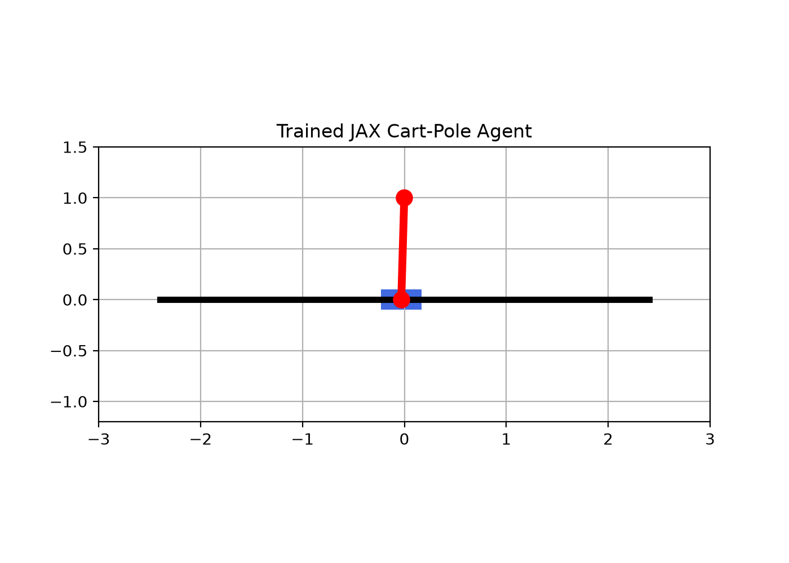

# JAX Cart-Pole Reinforcement Learning

A small actor-critic reinforcement learning project written in JAX. A neural network learns to balance a pole on a moving cart by pushing the cart left or right. Thousands of games run in parallel on the GPU/CPU using `jax.vmap` and `jax.lax.scan`.



## Project structure

| File | What it does |
|------|--------------|
| `environment.py` | Cart-pole physics, reset, step, and reward |
| `network.py` | Actor-critic neural network (Flax) |
| `rollout.py` | Runs many games in parallel and auto-resets finished ones |
| `train.py` | Loss function and training loop; saves weights to `trained_params.pkl` |
| `visualize.py` | Plays one episode with the trained network and saves `cartpole_demo.gif` |
| `runall.py` | Trains, then opens a live animation window |

## Setup

```bash
python -m venv .venv
source .venv/bin/activate        # Windows: .venv\Scripts\activate
pip install -r requirements.txt
```

## Usage

```bash
python train.py       # train and save weights
python visualize.py   # create cartpole_demo.gif from the saved weights
python runall.py      # train, then show a live animation
```

## How it works

1. Play 100 steps in 2,048 parallel games.
2. Compute discounted returns for each step.
3. Compare each return with the critic's estimate (the advantage).
4. Make actions that did better than expected more likely, and update the critic.
5. Repeat for 500 updates.

After training, the pole stays balanced for the full 500-step episode.
